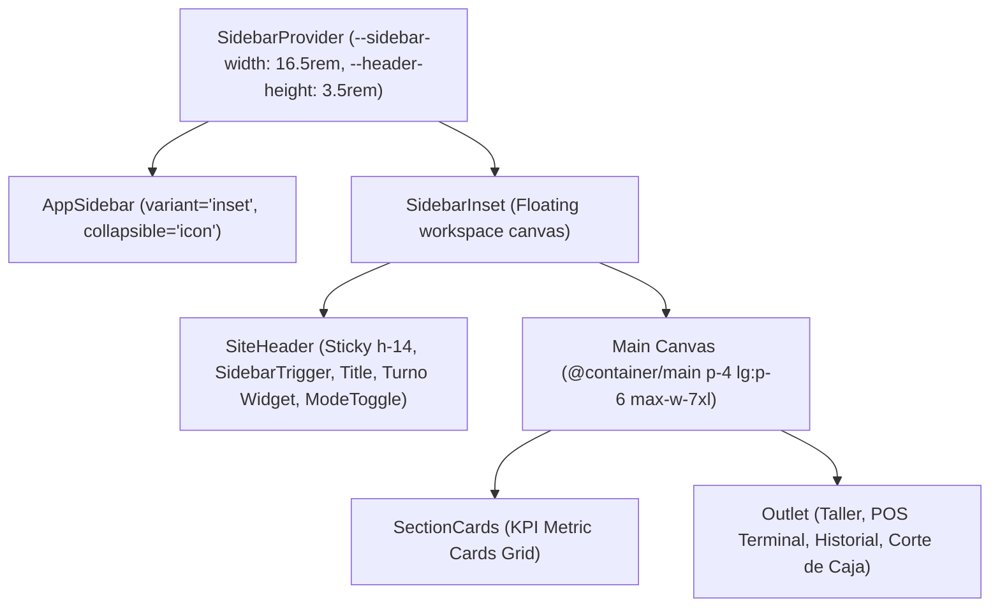

# TicketFlow Design System Guide

## 1. Dashboard Layout Architecture

TicketFlow employs a modern collapsible inset layout structured in four cooperating layers:



### 1.1 AppSidebar (`packages/frontend/src/components/layout/AppSidebar.tsx`)
- **Header:** Brand mark with icon container, "TicketFlow" title, and version badge.
- **Operaciones:** Core modules (`/taller`, `/pos`, `/pos/historial`, `/corte-caja`) with active state indicators and live counts (e.g. active tickets badge).
- **Acciones Rápidas:** Direct action triggers for "Nuevo Ticket" and "Abrir Turno / Arqueo".
- **Footer:** Operator card with user avatar, name, role badge, and quick screen lock action.
- **SidebarRail:** Interactive edge rail allowing click/drag collapse, paired with the universal `Ctrl+B` / `Cmd+B` keyboard shortcut.
- **Mobile Sheet:** Automatically renders as an off-canvas drawer on viewport widths below `768px`.

### 1.2 SiteHeader (`packages/frontend/src/components/layout/SiteHeader.tsx`)
- **Left Cluster:** `SidebarTrigger` toggle button, vertical separator, and active route title with module icon.
- **Right Cluster:**
  - **Live Cash Drawer Pill:** Real-time shift indicator with green checkmark, Shift ID, and animated currency calculation via `<NumberFlow />`.
  - **ModeToggle:** Instant theme cycling between Dark, Light, and System modes.
  - **User Lock Action:** One-click screen lock for operator handoff.

---

## 2. KPI Metric Cards (`SectionCards`)

Located at [`packages/frontend/src/components/layout/SectionCards.tsx`](file:///c:/Users/dualipin/Projects/ticketflow/packages/frontend/src/components/layout/SectionCards.tsx), this component sets the visual standard for data overview:

- **Grid Hierarchy:**
  ```css
  *:data-[slot=card]:from-primary/5 *:data-[slot=card]:to-card dark:*:data-[slot=card]:bg-card grid grid-cols-1 gap-4 *:data-[slot=card]:bg-gradient-to-t *:data-[slot=card]:shadow-xs @xl/main:grid-cols-2 @5xl/main:grid-cols-4
  ```
- **Container Queries:** Each card is marked `@container/card`, allowing typography to scale smoothly (`tabular-nums text-2xl @[250px]/card:text-3xl`).
- **Core Metrics:**
  1. **Taller Activo:** Total repair orders in diagnosis or service.
  2. **Listos para Entrega:** Completed repairs awaiting customer pickup and settlement.
  3. **Ventas del Turno:** Live total sales processed in the current shift.
  4. **Efectivo en Caja:** Real-time theoretical cash balance in the register.

---

## 3. Theming & Color Discipline

TicketFlow utilizes a dual-mode OKLCH neutral color foundation:

### 3.1 Dark Mode (Default)
- **Canvas (`--background`):** Deep near-black `oklch(0.145 0 0)`.
- **Surfaces (`--card`, `--popover`, `--sidebar`):** Elevated dark gray `oklch(0.205 0 0)`.
- **Borders (`--border`, `--input`):** 1px subtle hairline `oklch(1 0 0 / 10%)`.
- **Typography (`--foreground`):** High-contrast white `oklch(0.985 0 0)`.

### 3.2 Light Mode
- **Canvas (`--background`):** Clean white `oklch(1 0 0)`.
- **Surfaces (`--card`, `--popover`):** Crisp white `oklch(1 0 0)` with light sidebar `oklch(0.985 0 0)`.
- **Borders (`--border`, `--input`):** Defined neutral `oklch(0.922 0 0)`.
- **Typography (`--foreground`):** Deep neutral `oklch(0.145 0 0)`.

### 3.3 Semantic Accents
Saturated chromatic colors are strictly reserved for data visualization and status tags:
- **Success (`#59d499`):** Ready tickets, positive cash balance, cash sales.
- **Warning (`#ffc533`):** Unopened shifts, diagnostic pending, partial deposits.
- **Danger (`#ff6161`):** Cancelled tickets, cash discrepancies, destructive actions.
- **Info (`#57c1ff`):** Card / transfer transactions, customer metadata.

---

## 4. Components & Interactive States

### Buttons ([`button.tsx`](file:///c:/Users/dualipin/Projects/ticketflow/packages/frontend/src/components/ui/button.tsx))
- Built on `@base-ui/react/button` with `class-variance-authority`.
- Standard sizes: `h-8` (default), `h-7` (sm), `h-6` (xs), `h-9.5` (lg).
- Variants: `default` (high-contrast pill), `outline` (border-border), `ghost`, `secondary`, `destructive`.
- Focus ring: `focus-visible:ring-2 focus-visible:ring-ring/30`.

### Cards ([`card.tsx`](file:///c:/Users/dualipin/Projects/ticketflow/packages/frontend/src/components/ui/card.tsx))
- Structure: `Card` -> `CardHeader` -> `CardTitle` + `CardAction` + `CardDescription` -> `CardContent` -> `CardFooter`.
- Radius: `rounded-xl` with `ring-1 ring-border/50` or `border border-border`.

### Badges ([`badge.tsx`](file:///c:/Users/dualipin/Projects/ticketflow/packages/frontend/src/components/ui/badge.tsx))
- Compact pill shape (`rounded-3xl` / `rounded-full`), `h-5` or `h-5.5`, with semantic outline or soft tinted backgrounds.

---

## 5. Do's and Don'ts

### Do
- Use **semantic color tokens** (`bg-background`, `bg-card`, `text-foreground`, `border-border`) so components adapt automatically to both Light and Dark themes.
- Wrap numerical figures and currency with `<NumberFlow />` for smooth, mechanical digit transitions.
- Use **container query classes** (`@container/main`, `@container/card`) for cards and layout blocks that must adapt to sidebar expansion.
- Import icons exclusively from `lucide-react` using `data-icon="inline-start"` or `data-icon="inline-end"` inside buttons.
- Use `flex` / `grid` with `gap-*` for all spatial layout.
- Maintain `16px` base root font size (`1rem = 16px`).

### Don't
- **Never add paid third-party registries to `components.json`**. TicketFlow is 100% free and uses standard open-source shadcn/ui.
- **Never hardcode dark-only background colors** like `#07080a` or `#0d0d0d` in component classes; use `bg-background` and `bg-card`.
- **Never use legacy `space-y-*` or `space-x-*` utilities**; use `flex flex-col gap-*`.
- **Never use arbitrary width/height for square icons**; use `size-*` (`size-3.5`, `size-4`, `size-5`).
- **Never disable the sidebar collapsible behavior** on desktop; allow users to toggle it with `Ctrl+B`.
